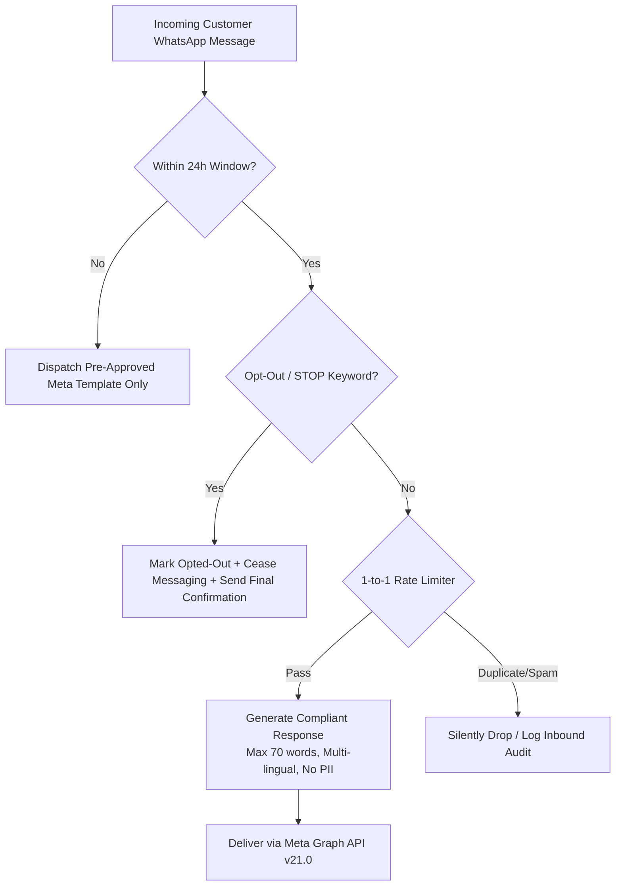

# Meta WhatsApp Business Messaging Compliance & Anti-Ban Standards

> **Company-Wide Engineering & Automation Standard for All WhatsApp Client Deployments**  
> **Applies To:** Hemkar Realty, MoolTatva Foods, Grano Satva, and all current and future client projects.  
> **Objective:** Maintain permanent **`GREEN` Quality Rating** on Meta Cloud API, prevent phone number blocks, eliminate spam complaints, and ensure 100% compliance with Meta Business Policies and Indian DPDP Act.

---

## 1. Core Architectural Invariants

Every WhatsApp automation workflow built across all client projects MUST implement the following 6 guardrails:

### 1. Inbound 24-Hour Customer Care Window
- Free-form AI conversational messaging is strictly restricted to **inbound customer sessions** within 24 hours of the customer's last message.
- Outbound proactive marketing or follow-up past 24 hours requires a registered and Meta-approved **WhatsApp Message Template**.

### 2. Mandatory Opt-Out / STOP Handling
- The workflow MUST recognize opt-out keywords: `STOP`, `UNSUBSCRIBE`, `DON'T MESSAGE`, `CANCEL`, `थांबवा`, `बंद करा`, `रोको`.
- Upon detection:
  1. Instantly set customer status to `opted_out` in PostgreSQL.
  2. Suppress all automated marketing or conversational responses.
  3. Send an opt-out confirmation message.

### 3. Anti-Flooding & 1-to-1 Response Dispatch
- For each unique customer message ID received, the system dispatches at most **one** response.
- Automated workflows must never loop, retry endlessly on client-side errors, or send duplicate message bodies.

### 4. Content Integrity & Transparency
- Clearly identify the business name in welcome greetings.
- No misleading pricing, deceptive claims, or artificial urgency.
- Facts must originate solely from verified database records (e.g. `property_inventory` for Real Estate, `product_catalog` for Foods).

### 5. Sensitive PII Prohibition
- Under no circumstances should automated workflows request or collect:
  - Banking credentials, OTPs, PINs, or CVVs.
  - Aadhaar numbers, PAN numbers, or biometric data.

### 6. Concise & High-Quality Message Formatting
- Responses must be bounded (maximum **70 words** or **3 sentences**).
- Avoid walls of text. Use bullet points and line breaks.
- Match customer language (English, Marathi, Hindi).

---

## 2. Phone Quality Rating Protocol

All client production WhatsApp numbers must be monitored in Meta WhatsApp Manager:

| Quality Rating | Action Required |
| :--- | :--- |
| 🟢 **GREEN (High)** | Normal operation. |
| 🟡 **YELLOW (Medium)** | Warning trigger. Reduce proactive messaging frequency; review recent conversation logs in dashboard. |
| 🔴 **RED (Low / Critical)** | Emergency trigger. Halt automated workflows; investigate customer feedback and opt-out rate. |

---

## 3. Client Implementation Matrix

| Client ID | Production Phone Number | WABA ID | Status | Compliance Standard Version |
| :--- | :--- | :--- | :--- | :--- |
| `hemkar-realty` | `+91 86001 44633` | `2503119533407699` | **LIVE (Quality: GREEN)** | v1.0 (Strict DPDP & Meta Graph API v21.0) |
| `mool-tatva` | `+91 98927 55388` | Configured | **ACTIVE** | v1.0 (Strict DPDP & Meta Graph API v21.0) |
| `grano-satva` | Configured | Configured | **ACTIVE** | v1.0 (Strict DPDP & Meta Graph API v21.0) |
