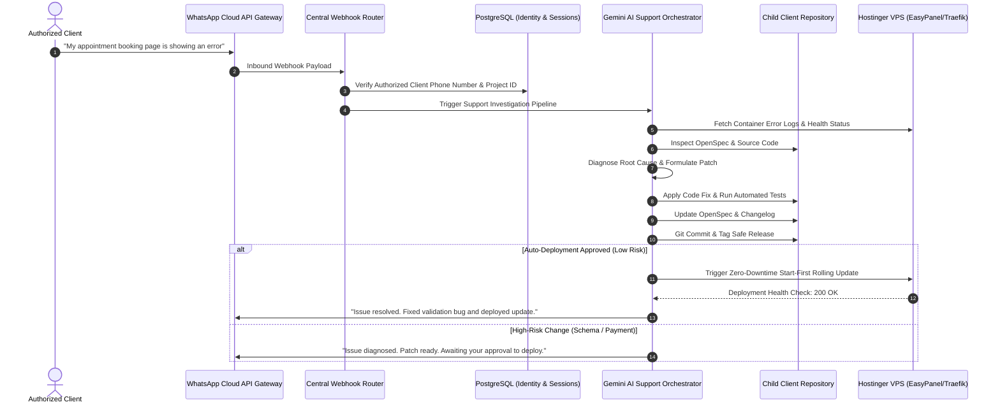

# Future WhatsApp-Driven Client Support Architecture

> **Architecture specification for autonomous, AI-driven client support, issue intake, diagnostic triage, and safe patch deployment via WhatsApp.**

---

## 1. System Architecture & Lifecycle

---

## 2. Safety Gates & Risk Classification

| Risk Level | Description | Execution Policy |
| :--- | :--- | :--- |
| **Low Risk (Tier 1)** | UI formatting, typo fix, static content update, client text revision | Autonomous test, commit, push, and deploy to Hostinger VPS. |
| **Medium Risk (Tier 2)** | Workflow logic update, email notification template, non-breaking API tweak | Autonomous test and commit; requires client/admin confirmation to deploy. |
| **High Risk (Tier 3)** | Database schema migration, payment gateway changes, credential rotations | Requires Lead Architect manual review and explicit approval. |

---

## 3. Security & Anti-Spoofing Protocols
- **Phone Number Whitelisting:** Only verified phone numbers registered in `registry/clients.yaml` can trigger support workflows.
- **HMAC Webhook Verification:** All Meta WhatsApp Cloud API webhooks verified with SHA-256 signatures.
- **Zero Cross-Client Leakage:** AI agent session is restricted strictly to the identified client's repository and database schema.
